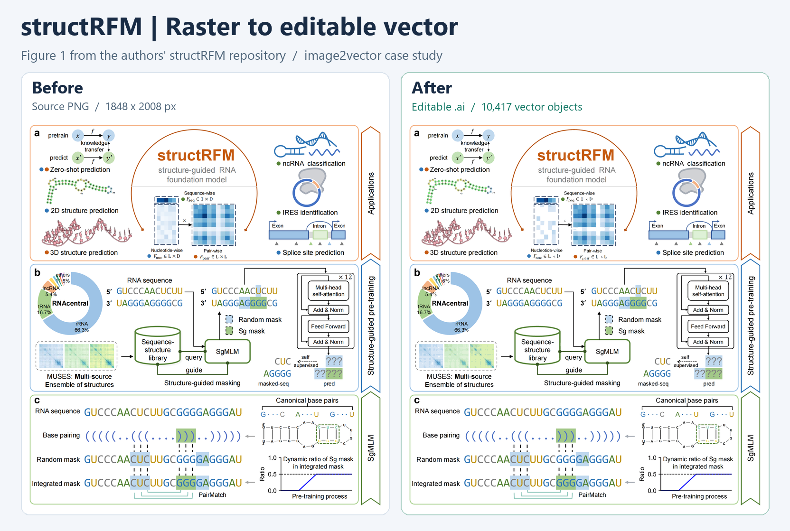

# image2vector

**English** · [简体中文](README_CN.md)

Convert PNG, JPEG, TIFF, BMP, or WebP images into editable Illustrator `.ai` paths, with an SVG copy and a white-background PNG preview. image2vector provides a skill for Codex and a skill for WorkBuddy. VectorCraft runs the conversion locally.

## Case study · structRFM architecture



The traced figure has 33 independently selectable groups. The case study shows how VectorCraft CLI moves the pairwise feature matrix on its own. [See the editing demo](examples/structrfm/README.md) · [Download the editable .ai](examples/structrfm/structrfm-editable.ai) · [Zhu et al., *Nature* (2026)](https://doi.org/10.1038/s41586-026-11210-2)

## One-command installation

Install CPython 3.11 or later, pip 22.3 or later, and VectorCraft with support for `--safe-mode` and Image Trace. The commands below also require Git. The `vectorcraft-cli` executable is in the VectorCraft installation directory. [Download VectorCraft](https://getartcraft.com/apps/vectorcraft)

**Windows PowerShell**

```powershell
$image2vectorDir = Join-Path ([IO.Path]::GetTempPath()) ("image2vector-" + [guid]::NewGuid().ToString("N")); git clone --depth 1 https://github.com/Hongxuan-Wu/image2vector.git $image2vectorDir; if ($LASTEXITCODE -eq 0) { python -I -B (Join-Path $image2vectorDir "install.py") --target both }
```

**Bash on macOS or Linux**

```bash
image2vector_dir="$(mktemp -d)" && git clone --depth 1 https://github.com/Hongxuan-Wu/image2vector.git "$image2vector_dir" && python3 -I -B "$image2vector_dir/install.py" --target both
```

You can also download the source from **Code → Download ZIP** on GitHub. Extract the archive and run `python -I -B install.py --target both` from the extracted directory. Use `python3` on macOS or Linux. To install for just one client, replace `both` with `codex` or `workbuddy`.

| Client | Fresh install location |
| --- | --- |
| Codex | `~/.agents/skills/image2vector` |
| WorkBuddy | `~/.workbuddy/skills/image2vector` |

The installer creates an isolated environment at `~/.image2vector/install-*/venv`, downloads the pinned Pillow 13.0.0 wheel from PyPI, and verifies its hash. Use `--python` to point to an existing Python 3.11+ environment with Pillow 13.0.0. During an upgrade, the installer moves recognized skill directories to that installation's `backups/` directory. Existing Codex installations under `~/.codex/skills` can be upgraded in place.

## Usage

Start a new chat, attach an image, and ask “Use image2vector to convert this image into an editable Illustrator file.” Use `$image2vector` in Codex or select **Image to Vector** from the WorkBuddy skill list.

The default outputs are `figure.ai`, `figure.svg`, and `figure-preview.png`. Specify a new output path when a file with the same name already exists. Conversion details and candidate outputs are saved in `.ai-work/job-*/` beside the output, along with a copy of the input pixels with metadata removed.

On Windows, you can run the script from a fresh Codex installation with PowerShell.

```powershell
$skillRoot = Join-Path $env:USERPROFILE '.agents/skills/image2vector'
$image2vectorPython = (Get-Content -LiteralPath (Join-Path $skillRoot 'python-path.txt') -Raw -Encoding UTF8).Trim()
& $image2vectorPython -I -B (Join-Path $skillRoot 'scripts/image2vector.py') --mode flat -o '.\result.ai' -- '.\figure.png'
```

| Option | Purpose |
| --- | --- |
| `-o` | Set the path for the new `.ai` file |
| `--mode auto│flat│photo│bw` | Use automatic profile selection, flat artwork, photo, or black-and-white line art |
| `--max-colors 4…64` | Set the photo profile's color budget, which defaults to 24 |
| `--scale` | Scale the artboard, which defaults to one point per pixel |
| `--no-preview`, `--no-svg` | Skip the corresponding output |
| `--vc-cli` | Set the absolute path to a trusted VectorCraft executable |
| `--work-dir` | Set the directory for intermediate files |

In `auto` mode, an empty or failed tracing candidate is recorded and the remaining candidate is tried. Images larger than 3 MP also try the flat profile. The best successful candidate is chosen by rendered error within the existing color-budget guard; if every candidate fails, conversion fails. The JSON `candidates` list includes each candidate's `ok` status and any `error`, and skipped candidates are included in `warnings`. Large photographs may take longer because two candidates are tried; use `--mode photo` when a limited palette is intended.

If VectorCraft cannot be found, point `VECTORCRAFT_CLI` to the local executable or write its absolute path to `~/.config/image2vector/vectorcraft-cli`. The legacy configuration file also works.

## Output and limitations

- Conversion runs locally in VectorCraft Safe Mode. The skill decodes the bitmap, passes a PNG with metadata removed to VectorCraft, then reopens the `.ai` to check its path objects before delivery.
- The input file limit is 128 MiB. The input image and scaled artboard each have a limit of 32 million pixels and 16,384 pixels per side. Conversion uses the first frame of a multi-frame file.
- Text becomes outlines, gradients and photos are quantized into color regions, and strokes become filled paths.
- Version 1.2.1 was tested on Linux with VectorCraft 0.24.1 and Pillow 13.0.0, including isolated installations for both clients. Windows was verified for v1.2.0; v1.2.1 on Windows and macOS still need verification.

## Development and verification

`codex/` and `workbuddy/` contain the skill definitions. `shared/` contains the common runtime. The installer combines the relevant definition and runtime into a complete skill directory.

```bash
python -I -B tests/test_auto.py
python -I -B tests/test_safety.py
python -I -B tests/test_conversion.py --output-root out/acceptance
```

The automatic-selection unit tests simulate engine replies and do not require VectorCraft. The full conversion tests use the real engine, include light-gray and 2048 × 1536 64-color fixtures, and also require PyMuPDF to inspect the `.ai` file's PDF layer independently. The palette regression checks both the trace color count and all 64 swatches in the rendered preview.

[MIT License](LICENSE) · [Codex Skills documentation](https://learn.chatgpt.com/docs/build-skills) · [WorkBuddy Skills documentation](https://open.workbuddy.cn/docs/skill)
