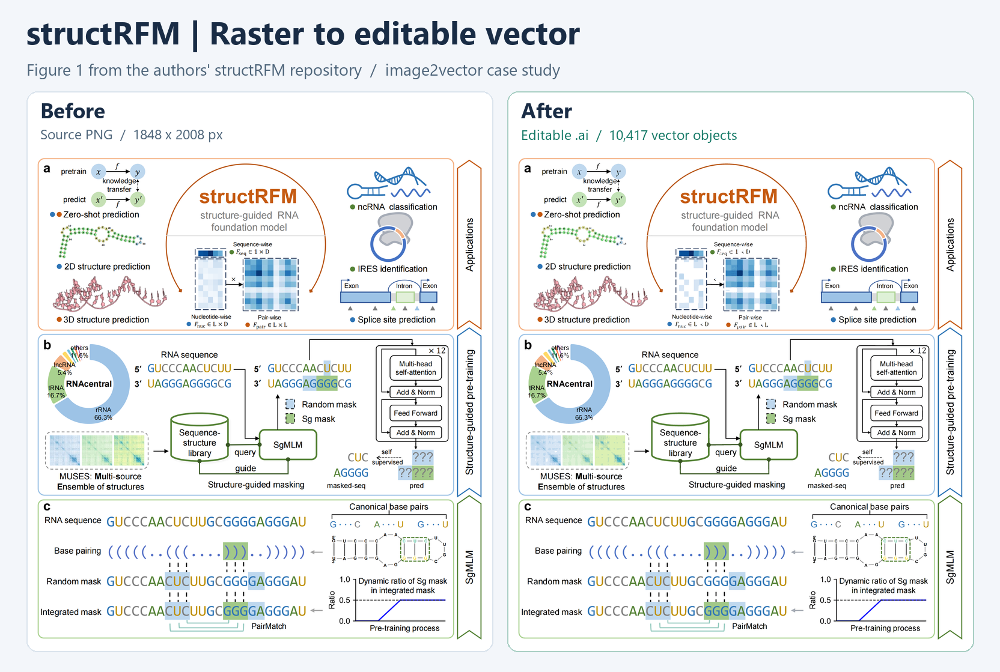

# image2vector

[English](README.md) · **简体中文**

把 PNG、JPEG、TIFF、BMP 或 WebP 转成可在 Adobe Illustrator 中编辑的 `.ai` 矢量路径，附带 SVG 和白底 PNG 预览。Codex 和 WorkBuddy 各有一个技能入口，转换由本机 VectorCraft 完成。

## 真实案例 · structRFM 架构图



原位图经描摹后整理为 33 个可独立选择的分组。案例用 VectorCraft CLI 展示了单独移动配对特征矩阵的效果。 [查看元素拆分与编辑演示](examples/structrfm/README_CN.md) · [下载可编辑 .ai](examples/structrfm/structrfm-editable.ai) · [Zhu 等，*Nature*（2026）](https://doi.org/10.1038/s41586-026-11210-2)

## 一键安装

准备 CPython 3.11 或更新版本、pip 22.3 或更新版本，以及支持 `--safe-mode` 和 Image Trace 的 VectorCraft。下面的命令还需要 Git。可在 VectorCraft 安装目录中找到 `vectorcraft-cli`。 [下载 VectorCraft](https://getartcraft.com/apps/vectorcraft)

**Windows PowerShell**

```powershell
$image2vectorDir = Join-Path ([IO.Path]::GetTempPath()) ("image2vector-" + [guid]::NewGuid().ToString("N")); git clone --depth 1 https://github.com/Hongxuan-Wu/image2vector.git $image2vectorDir; if ($LASTEXITCODE -eq 0) { python -I -B (Join-Path $image2vectorDir "install.py") --target both }
```

**macOS 或 Linux 的 Bash**

```bash
image2vector_dir="$(mktemp -d)" && git clone --depth 1 https://github.com/Hongxuan-Wu/image2vector.git "$image2vector_dir" && python3 -I -B "$image2vector_dir/install.py" --target both
```

也可以通过 GitHub 的 **Code → Download ZIP** 获取源码，在解压目录运行 `python -I -B install.py --target both`（macOS 或 Linux 使用 `python3`）。只装一个客户端时，把 `both` 改为 `codex` 或 `workbuddy`。

| 客户端 | 新安装的位置 |
| --- | --- |
| Codex | `~/.agents/skills/image2vector` |
| WorkBuddy | `~/.workbuddy/skills/image2vector` |

安装器在 `~/.image2vector/install-*/venv` 创建隔离环境，从 PyPI 下载并校验锁定的 Pillow 13.0.0 wheel。可用 `--python` 指定已有的 Python 3.11+ 环境，该环境须含 Pillow 13.0.0。升级时，识别到的旧技能目录会移到同一次安装的 `backups/`。使用 `~/.codex/skills` 的已有 Codex 安装可在原位置升级。

## 使用

安装后新开一个对话、附上图片，然后发送「用 image2vector 把这张图转成 Illustrator 可编辑的 AI 文件」。Codex 可以用 `$image2vector` 调用。WorkBuddy 可以在技能列表选择「图片转矢量图」。

默认产物为 `图.ai`、`图.svg`、`图-preview.png`。已有同名文件时请指定新的输出路径。转换详情与候选结果保存在输出旁的 `.ai-work/job-*/`。这当中会保留去除输入元数据的像素副本。

Windows 上可以用 PowerShell 调用 Codex 新装目录中的脚本。

```powershell
$skillRoot = Join-Path $env:USERPROFILE '.agents/skills/image2vector'
$image2vectorPython = (Get-Content -LiteralPath (Join-Path $skillRoot 'python-path.txt') -Raw -Encoding UTF8).Trim()
& $image2vectorPython -I -B (Join-Path $skillRoot 'scripts/image2vector.py') --mode flat -o '.\result.ai' -- '.\figure.png'
```

| 参数 | 用途 |
| --- | --- |
| `-o` | 设置新 `.ai` 的路径 |
| `--mode auto│flat│photo│bw` | 自动选档、扁平图、照片或黑白线稿 |
| `--max-colors 4…64` | 设置照片档色数，默认 24 |
| `--scale` | 设置画板倍率，默认一像素对应一 pt |
| `--no-preview`、`--no-svg` | 跳过相应的副本 |
| `--vc-cli` | 指定可信 VectorCraft 可执行文件的绝对路径 |
| `--work-dir` | 指定中间文件目录 |

`auto` 模式会记录零路径或报错的候选，并继续尝试其余候选。超过 3 MP 的图片也会尝试扁平图档。在原有色数约束内按渲染误差选择成功候选；全部候选失败时仍返回失败。JSON 的 `candidates` 列表记录各候选的 `ok` 状态与 `error`，跳过候选的原因也会写入 `warnings`。大照片多试一个候选可能增加耗时；明确需要有限色板时可使用 `--mode photo`。

如果找不到 VectorCraft，将 `VECTORCRAFT_CLI` 指向实际的本地可执行文件，或把绝对路径写入 `~/.config/image2vector/vectorcraft-cli`。旧版同名配置文件继续适用。

## 输出与限制

- 转换使用本机 VectorCraft 的 Safe Mode。程序先解码位图，再把去除元数据的 PNG 交给引擎，发布前重新打开 `.ai` 检查路径对象。
- 输入上限为 128 MiB。源图与缩放后的画板上限均为 3,200 万像素，单边上限为 16,384。多帧文件处理首帧。
- 字体描摹为轮廓，渐变和照片量化为色块，描边最终表现为填充路径。
- 1.2.1 在 Linux 上使用 VectorCraft 0.24.1、Pillow 13.0.0 完成验收，包括两个客户端的隔离安装。Windows 的验证版本为 1.2.0；1.2.1 的 Windows 和 macOS 验证仍待完成。

## 开发与验收

`codex/` 和 `workbuddy/` 各自存放技能定义，`shared/` 提供共同的运行代码。安装器将对应定义和运行代码装配成完整的技能目录。

```bash
python -I -B tests/test_auto.py
python -I -B tests/test_safety.py
python -I -B tests/test_conversion.py --output-root out/acceptance
```

自动选档单元测试模拟引擎返回，不需要 VectorCraft。完整转换验收使用真实引擎，包含浅灰图和 2048 × 1536 的 64 色图，还需要测试环境中的 PyMuPDF 独立读取 AI 文件的 PDF 层。色板回归同时检查描摹报告的色数，以及渲染预览中全部 64 个色块的颜色。

[MIT 许可证](LICENSE) · [Codex Skills 文档](https://learn.chatgpt.com/docs/build-skills) · [WorkBuddy 技能文档](https://open.workbuddy.cn/docs/skill)
