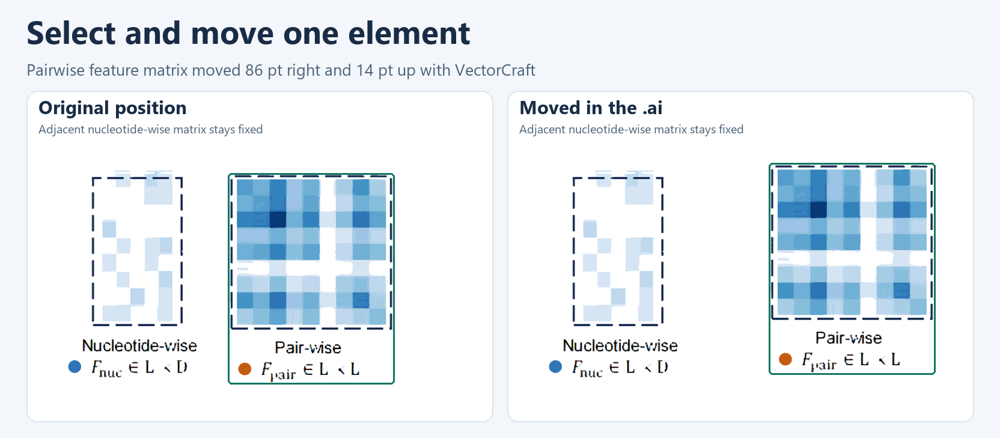

# Case study · structRFM architecture

**English** · [简体中文](README_CN.md)

The authors' structRFM architecture figure was traced into an editable `.ai` file. The result preserves the three panels on applications, structure-guided pre-training, and masking. The original bitmap measures 1848 × 2008 pixels.

[Download the editable .ai](structrfm-editable.ai) · [Original bitmap](before.png) · [Vector render](after.png)

## Before and after

The left panel shows the PNG from the authors' repository. The right panel shows the rendering after VectorCraft CLI reopened the final `.ai`. Both are shown at the same scale.


## Moving one element

In a temporary session, VectorCraft CLI opens the final `.ai`, isolates two adjacent groups, and moves the selected pairwise feature matrix 86 pt to the right and 14 pt up. The neighboring nucleotide-wise feature matrix stays in place. The green outlines show the measured selection bounds.



## Separated elements

The reopened `.ai` contains **4 layers, 33 named groups, and 10,417 path or compound path objects**. Inspection of the PDF layer found zero embedded bitmaps. Expand a layer to select a whole module or edit individual paths in its group. Text is outlined, and connected regions of the same color may share a path.


## Conversion and source figure

From the repository root, run image2vector using the Python environment created by the installer.

```bash
python -I -B shared/scripts/image2vector.py --mode flat -o out/structrfm-traced.ai -- examples/structrfm/before.png
```

For this case study, the traced paths were organized into named groups based on their positions in the figure. VectorCraft CLI exported and reopened the `.ai` to verify selection, movement, and rendering. The entire workflow runs from the command line.

The source bitmap is `images/Fig1.png` from Heqin Zhu and colleagues' structRFM repository. The adaptations include tracing the bitmap, grouping the paths by module, and producing comparisons. The original MIT license accompanies the example. [Source figure](https://github.com/heqin-zhu/structRFM/blob/13be9088d5201051abebcf31896cf370ae395c5f/images/Fig1.png) · [Upstream license and attribution](LICENSE-structRFM.txt)

## Paper citation

Zhu, H., Li, R., Chang, A. et al. An open structure-guided RNA foundation model for generalizable prediction. *Nature* (2026). [DOI 10.1038/s41586-026-11210-2](https://doi.org/10.1038/s41586-026-11210-2)
