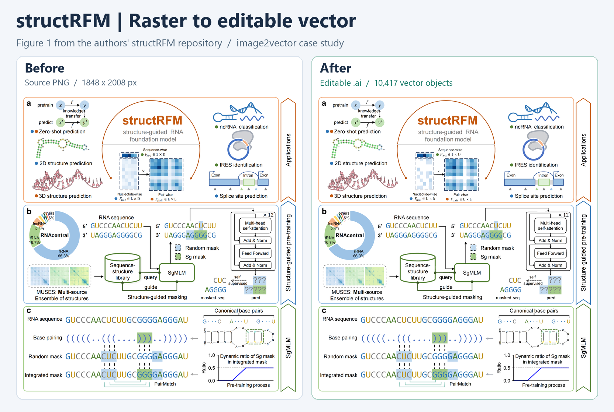
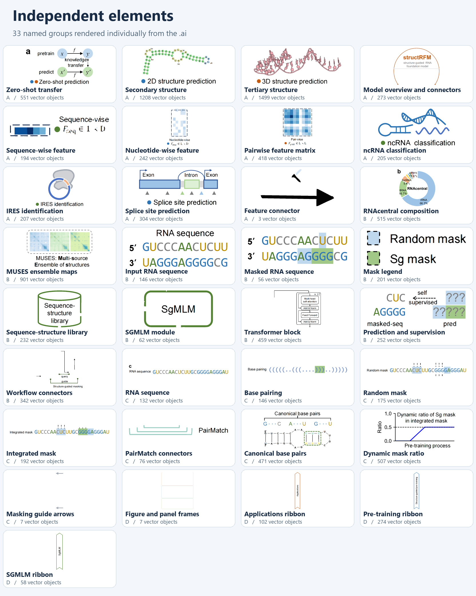

# structRFM 架构图案例

把作者发布的 structRFM 架构位图转成可编辑的 `.ai` 文件。保留应用、结构引导预训练和掩码策略三个面板。原图尺寸为 1848 × 2008 像素。

[下载可编辑 .ai](structrfm-editable.ai) · [原始位图](before.png) · [矢量渲染](after.png)

## 矢量化前后

左侧是作者仓库的 PNG，右侧是 VectorCraft CLI 重开最终 `.ai` 后的渲染。两侧比例相同。



## 单独移动一个元素

VectorCraft CLI 在最终 `.ai` 的临时会话中显示两个相邻分组，选中配对特征矩阵并向右移动 86 pt、向上移动 14 pt。相邻的核苷酸特征矩阵边界保持原位。绿框标注测得的选中边界。


## 元素拆分

`.ai` 重开后包含 **4 个图层、33 个命名分组和 10,417 个路径或复合路径对象**。PDF 层检查确认嵌入位图数量为 0。展开图层可以选中整个模块，再编辑分组中的路径。文字采用轮廓，相邻且相连的同色区域可能共享路径。



## 转换与来源

用 README 安装的 Python 环境从仓库根目录运行 image2vector。

```bash
python -I -B shared/scripts/image2vector.py --mode flat -o out/structrfm-traced.ai -- examples/structrfm/before.png
```

本案例将描摹后的路径按图中位置重组并命名，再用 VectorCraft CLI 导出和重开 `.ai`，完成选择、移动和渲染验证。整个案例流程由命令行完成。

输入为 Heqin Zhu 等人在项目仓库发布的 `images/Fig1.png`。改动包括位图描摹、按模块分组和制作对照图。随案例保留原始 MIT 许可。 [作者发布的原图](https://github.com/heqin-zhu/structRFM/blob/13be9088d5201051abebcf31896cf370ae395c5f/images/Fig1.png) · [上游许可和署名](LICENSE-structRFM.txt) · [研究论文](https://doi.org/10.1038/s41586-026-11210-2)
